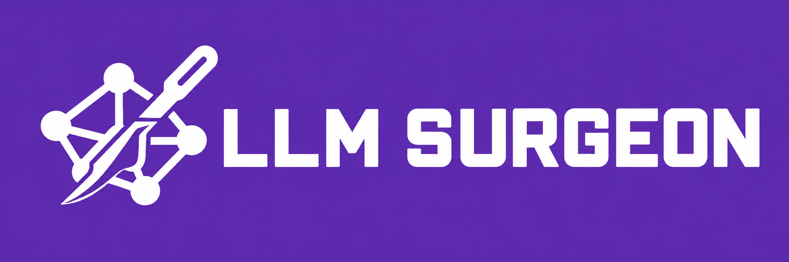
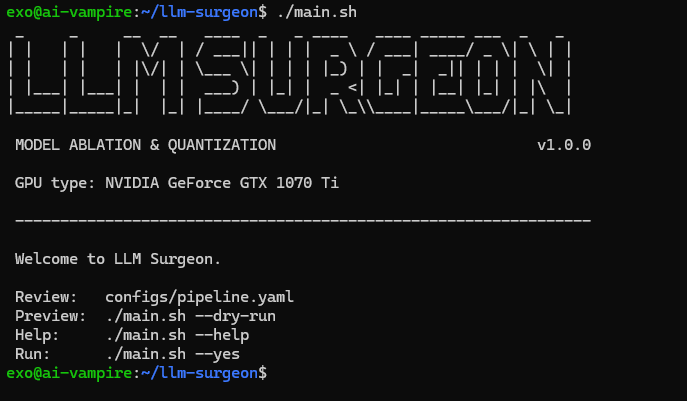

<p align="center"></p>

# LLM Surgeon (Abliterate and Quantize)

[](pyproject.toml)
[](pyproject.toml)
[](docs/deployment-ubuntu.md)
[](docs/limitations.md)
[](https://github.com/NetwCodeProjects/llm-surgeon/commits/main)

[](https://github.com/p-e-w/heretic/commit/171bb98b8b9a41c081631b5e678f7133128973e0)
[](https://github.com/ggml-org/llama.cpp/releases/tag/b11889)
[](https://github.com/vllm-project/vllm)
[](https://github.com/vllm-project/llm-compressor)
[](https://github.com/astral-sh/uv)
[](https://github.com/astral-sh/ruff)

Abliterates a Hugging Face model with [Heretic](https://github.com/p-e-w/heretic), qualifies the result,
keeps it as an immutable BF16 master and exports FP8 (llm-compressor) and GGUF (llama.cpp), each loaded and
compared with the master before it counts. Optionally publishes to Hugging Face. Every artifact has a
manifest with checksums and lineage.

> **Compatibility notice.** This platform does not automatically verify that your model architecture
> is supported by the selected abliteration engine or quantization backend. Verify compatibility with
> the engines' official documentation before execution. Unsupported models or formats may fail during
> model loading, transformation, or export. The platform manages execution, dependencies, logs, and
> artifacts but does not guarantee compatibility with every model.

## Requirements

```text
OS:    Ubuntu 22.04/24.04, or a cloud GPU's PyTorch template (e.g. runpod/pytorch)
GPU:   NVIDIA with driver; small models also run on CPU (configs/acceptance/local-cpu.yaml)
Disk:  3–4× the model's BF16 size (the 27B release plans 500 GB)
```

The tools are installed by the program, pinned, inside the repository and the workspace. A missing host
package is reported with its install command.

## Profiles

A profile holds the settings one model architecture needs: which tensors FP8 must skip, which GGUF
converter version to use, which tensors to restore after abliteration. `configs/pipeline.yaml` loads it:

```yaml
profiles:
  - profiles/qwen3_5.yaml    # Qwen3.5 and Qwen3.8 models
```

Profiles are per architecture, not per model. Qwen3.8-27B uses qwen3_5.yaml because it's`config.json`
says `"model_type": "qwen3_5"`. For a model with a different `model_type`, write a profile in
`configs/profiles/` and list it here.

To find which profile a model needs, open its `config.json`
(`https://huggingface.co/<org>/<model>/blob/main/config.json`) and read `model_type`.

## Usage

```text
Review:   configs/pipeline.yaml
Model:    configs/pipeline.yaml/model.url, model.revision (null = latest commit)
Preview:  ./main.sh --dry-run
Run:      ./main.sh --yes
Resume:   ./main.sh --resume RUN_ID
Publish:  ./main.sh --publish RUN_ID
Help:     ./main.sh --help
```



`--yes` skips confirmation prompts. Publishing follows `publish:` in the config: the shipped one uploads
public without asking. With `enabled: ask`, a new run asks first (`--yes` does not answer it): publish or
not, repository name, private or public, the formats by bit level. Uploads happen only when the run's
release record says `ready` ([release](docs/release.md)).

Another model: set `evaluation.published_baselines: null` unless you have that model's published numbers.

Cloud GPU: workspace on the local disk (`--output-dir /root/ws`), run inside `tmux`, copy `exports/` out
before the instance stops.

```text
Stop early:     ./main.sh --through 2 --yes
Re-run stages:  ./main.sh --resume RUN_ID --from 5 --through 6 --rerun
Change config:  ./main.sh --resume RUN_ID --fork --quantizations fp8
Quantize only:  ./main.sh --model-url org/model --quantize-only --quantizations fp8,q4_k_m --yes
Inspect:        ./main.sh --status RUN_ID · --list-runs · --cleanup
Detail:         --verbose · --quiet
```

## Stages

| ID | Stage | Result |
|---|---|---|
| 00 | preflight | host facts, disk and VRAM checks |
| 01 | environment | pinned tool environments (reused across runs) |
| 02 | acquire | model at a pinned commit, every file verified |
| 03 | published_baselines | the model card's own metrics, recorded with their source |
| 04 | prepare_engine | Heretic configuration, validated against the installed Heretic |
| 05 | abliterate | budgeted, resumable search; the best trial within the gates is exported |
| 06 | qualify | held-out refusal, benign and integrity checks on the candidate |
| 07 | select_master | promotion gates → immutable master |
| 08 | quantize | FP8 and GGUF exports |
| 09 | verify_exports | each export loaded in its runtime (vLLM, llama-server) and compared with the master |
| 10 | report_export | manifests, report, run summary |

Step by step: [run walkthrough](docs/run-walkthrough.md).

## Status

Every stage has run end to end on a B300 (Qwen3.5-2B, native FP8 in vLLM) and an A100; each commit is
accepted on CPU first ([acceptance](docs/acceptance.md)). The Qwen3.8-27B release is one B300 run
([release](docs/release.md)). Verified and not verified: [limitations](docs/limitations.md).

## Outputs

```text
workspace/
├── exports/{bf16,fp8,gguf}/<name>/     deliverables, each with a manifest sidecar
├── runs/<run>/reports/report.md        stages, gates, loader tests, metric provenance, tool versions, time
├── runs/<run>/{logs,receipts,metrics}/ what happened, why, and the measurements
├── manifests/  assessments/            every artifact's manifest and its verification records
├── models/                             verified sources, candidates, the selected master
└── tools/  cache/                      pinned tool environments and caches
```

## Documentation

[run walkthrough](docs/run-walkthrough.md) · [cli](docs/cli.md) · [configuration](docs/configuration.md) ·
[release](docs/release.md) · [troubleshooting](docs/troubleshooting.md) · [limitations](docs/limitations.md) ·
[architecture](docs/architecture.md) · [stages](docs/stages.md) · [study lifecycle](docs/study-lifecycle.md) ·
[Heretic adapter](docs/heretic-adapter.md) · [quantization](docs/quantization.md) · [evaluation](docs/evaluation.md) ·
[assessments](docs/assessments.md) · [artifact schema](docs/artifact-schema.md) · [security](docs/security-and-trust.md) ·
[Ubuntu](docs/deployment-ubuntu.md) · [Lambda Stack profile](docs/deployment-lambda.md) · [acceptance](docs/acceptance.md) ·
[implementation log](docs/implementation-log.md) · [specification](docs/PROJECT_A_AGENT_HANDOFF.md) · [contributing](CONTRIBUTING.md)

## License

The project's own license is not chosen yet. Third-party tools keep theirs ([LICENSE-THIRD-PARTY.md](LICENSE-THIRD-PARTY.md));
Heretic is AGPL-3.0.
